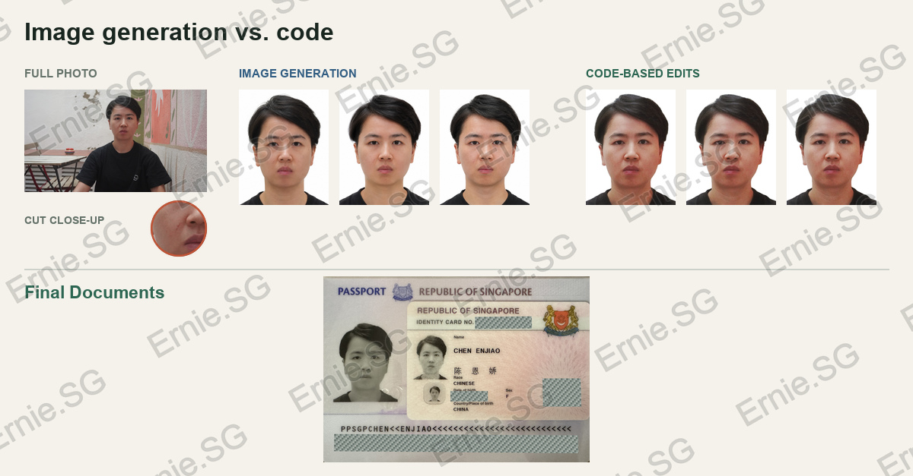

I recently became a Singapore citizen! 🇸🇬

Ironically, getting my citizenship approved wasn't the hardest part. Getting my passport photo accepted by ICA was.

I spent €40 and half a day getting my photo taken twice in Barcelona. Even the professionally edited photos got rejected.

So I did what any frustrated software engineer would do: I wrote code.

I experimented with image generation first, but it subtly changed my facial features. Not exactly ideal for an identity document. 😂

Code-based image processing worked better. I could remove the background, crop, resize, and even fix the temporary cut I got from hiking on my face.

And it got accepted!

*Image generation vs. code-based edits, with the final Singapore passport and IC below.*

That experience made me wonder: What products and services are we using everyday that no longer makes sense in a world of abundant intelligence?

## Everything is Code

The worst part wasn't the money or the time. It was that, after all that effort, the photos were still rejected! The photographer couldn't meet the exact specifications, down to the pixel, and every additional touch-up would cost another €20.

Then it occurred to me: who better than AI to measure whether my face occupies exactly the right proportion of a photograph?

And all those manual edits in Photoshop - cropping, background removal, clone stamping - are ultimately software operations. Operations that AI can now write and execute as code.

If the previous era of the internet gave us Software as a Service, perhaps the next will give us Outcomes as a Service.

I didn't want photo-editing software. I didn't even want a photographer. I just wanted a passport photo that would get accepted.

So I'm building Spindle Photos.

Take a selfie. Choose your country and document. Get photos formatted and checked against the relevant requirements, with unlimited exports for supported documents.

No studio visits. No Photoshop. No €40 surprises.

Here's a demo:

<iframe alt="Spindle Photos demo" src="https://www.youtube.com/embed/dWwgoHECl54?feature=oembed" allowfullscreen="true" style="width: 100%; aspect-ratio: 16 / 9; height: auto; border: 0; "></iframe>

It's a small part of a bigger idea I'm working on: Take all the things I hate doing - things I might never have gotten around to without AI - and make that capability accessible to everyone.

All thanks to a rejected passport photo. 😂
