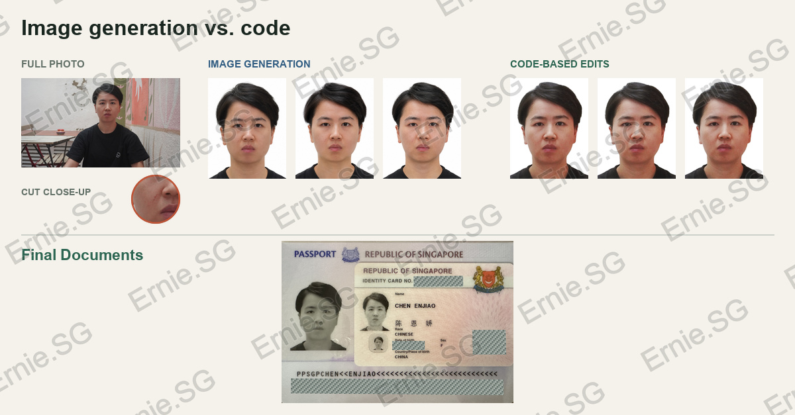

最近、シンガポールの市民権を取得しました!🇸🇬

皮肉なことに、一番大変だったのは市民権の承認ではなく、ICA(移民・検問局)にパスポート写真を受理してもらうことでした。

バルセロナで2回写真を撮り直し、40ユーロと半日を費やしました。プロが修正してくれた写真ですら、却下されたのです。

そこで、困り果てたソフトウェアエンジニアなら誰もがやることをしました。コードを書いたのです。

最初は画像生成を試しましたが、顔の特徴が微妙に変わってしまいました。身分証明書にはまったく向きません。😂

コードによる画像処理のほうがうまくいきました。背景の除去、トリミング、リサイズ、さらにはハイキングで顔にできた一時的な傷の修正まで、すべてできたのです。

そして、無事に受理されました!

*画像生成とコードによる編集の比較。下段は最終的なシンガポールのパスポートとIC。*

## すべてはコード

一番つらかったのは、お金や時間ではありませんでした。これだけ苦労したのに、それでも写真が却下されたことです。写真家はピクセル単位の正確な規格を満たせず、修正を重ねるたびにさらに20ユーロかかる状況でした。

そこでふと思いました。顔が写真の中でぴったり正しい割合を占めているかどうかを測るのに、AIほど適した存在はないのでは?

しかも、Photoshopでの手作業の編集、つまりトリミングも背景除去もクローンスタンプも、突き詰めればソフトウェアの操作です。今ではAIがコードとして書き、実行できる操作なのです。

そこで、**Spindle Photos**を作っています。

自撮りをして、国と書類を選ぶだけ。該当する要件に沿って整形・チェックされた写真が手に入り、対応する書類なら書き出しは無制限です。

スタジオに行く必要も、Photoshopも、40ユーロの思わぬ出費もありません。

**デモはこちらです:**

<iframe alt="Spindle Photos demo" src="https://www.youtube.com/embed/dWwgoHECl54?feature=oembed" allowfullscreen="true" style="width: 100%; aspect-ratio: 16 / 9; height: auto; border: 0; margin: 0 0 2rem; "></iframe>

## Software as a ServiceからOutcome as a Serviceへ

この体験から、ある疑問が浮かびました。**知性が豊富にある世界で、私たちが毎日使っている製品やサービスのうち、もはや意味をなさなくなっているものは何だろう?**

今使っているソフトウェアの多くは、決定論的なコンピューティングの時代から受け継がれたものです。私たちは、人間が本当に望むことではなく、コンピューターにできることを基準に、インターフェース、フォーム、メニュー、ワークフローを作ってきました。

でも今は、そこにモデルの知性を加えられるのです!

結局のところ、ボタンをクリックしたりフォームに記入したりするのが好きでソフトウェアを使う人はいません。大切な成果を得るために使うのです。ソフトウェアは、もともと目的を果たすための手段にすぎませんでした。

私が欲しかったのは、写真編集ソフトではありません。写真家ですらありませんでした。**ただ、受理されるパスポート写真が欲しかっただけです。**

そして、写真だけにとどめる理由があるでしょうか。

学校、病院、銀行、行政機関では、今でも同じ情報を何度も記入させられます。AIにフォームを向けるだけで、あとはうまく処理してくれたらいいのに、と思いませんか?

それに、AIがファイルを検索して答えを出すだけでは足りません。それぞれの情報をどこから得たのかを正確に知り、正しいか確認でき、足りない部分だけを聞いてほしいのです。

また、AIにはインターネットの平均的な文章のように書いてほしくもありません。私が本当に言いたいことを、私よりうまく表現しつつ、あくまで*私らしく*書いてほしいのです。

**既存のワークフローを遺物として守ることが目的ではありません。成果を軸に、ワークフローを設計し直すことが目的です。**

前のインターネットの時代がSoftware as a Serviceをもたらしたのなら、次の時代はOutcome as a Serviceをもたらすのかもしれません。

そして、AIによる生産性の向上が行き渡ってほしいのは、教育、医療、住まい、さらには行政とのやり取りといった日常の煩雑な手続きも含む、生活に欠かせないサービスです。

ソフトウェアが安くなったり、企業の利益率が上がったりするだけではなく、教師や医療従事者の事務作業が減り、市民がくぐらなければならない関門が減り、誰もが本当に大切なことに使える時間が増えてほしいのです。

私たちは何十年もかけて、コンピューターの使い方を学んできました。これからは、コンピューターのほうが私たちに合わせて動くようにできるチャンスです。

それが**Spindle**の大きな構想です。自分がやりたくないこと、AIがなければ手をつけなかったかもしれないことを引き受けて、その力を誰もが使えるようにします。

というわけで……30日後にローンチ?🚀
