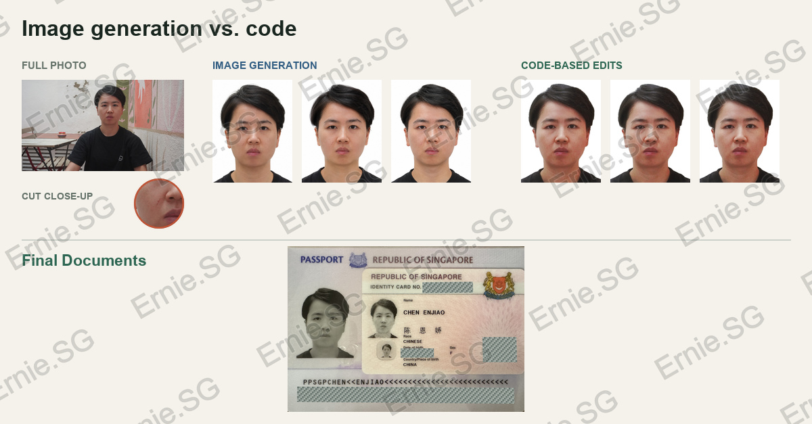

최근 싱가포르 시민권을 받았습니다! 🇸🇬

아이러니하게도 시민권 승인보다 더 어려웠던 건 ICA에서 여권 사진을 승인받는 일이었습니다.

바르셀로나에서 사진을 두 번 찍느라 40유로와 반나절을 썼습니다. 전문가가 보정한 사진조차 반려되었습니다.

그래서 답답한 소프트웨어 엔지니어라면 누구나 그렇듯 코드를 짰습니다.

처음에는 이미지 생성 AI를 써 봤는데, 얼굴 특징이 미묘하게 바뀌더군요. 신분증 사진으로는 영 좋지 않죠. 😂

코드 기반 이미지 처리가 훨씬 나았습니다. 배경 제거, 자르기, 크기 조정은 물론 등산하다 얼굴에 생긴 일시적인 상처까지 지울 수 있었습니다.

그리고 드디어 승인되었습니다!

*이미지 생성 vs. 코드 기반 보정, 아래는 최종 싱가포르 여권과 IC입니다.*

## 모든 것은 코드다

가장 힘들었던 건 돈이나 시간이 아니었습니다. 그렇게 애를 썼는데도 사진이 또 반려되었다는 점이었습니다. 사진사는 픽셀 단위의 정확한 규격을 맞추지 못했고, 보정을 한 번 더 할 때마다 20유로가 추가되는 구조였습니다.

그때 생각이 들었습니다. 내 얼굴이 사진에서 정확히 올바른 비율을 차지하는지 측정하는 일에 AI보다 더 적합한 존재가 있을까요?

게다가 포토샵에서 손으로 하는 보정, 즉 자르기, 배경 제거, 복제 도장 같은 작업은 결국 모두 소프트웨어 연산입니다. 이제는 AI가 코드로 작성하고 실행할 수 있는 연산이죠.

그래서 **Spindle Photos**를 만들고 있습니다.

셀카를 찍고, 국가와 서류를 고르세요. 해당 요건에 맞게 형식을 갖추고 검증된 사진을 받을 수 있으며, 지원되는 서류는 내보내기 횟수에 제한이 없습니다.

스튜디오 방문도, 포토샵도, 40유로짜리 뒤통수도 없습니다.

**데모 영상입니다.**

<iframe alt="Spindle Photos demo" src="https://www.youtube.com/embed/dWwgoHECl54?feature=oembed" allowfullscreen="true" style="width: 100%; aspect-ratio: 16 / 9; height: auto; border: 0; margin: 0 0 2rem; "></iframe>

## 서비스형 소프트웨어에서 서비스형 결과로

이 경험을 하면서 궁금해졌습니다. **풍부한 지능이 넘치는 세상에서, 우리가 매일 쓰는 제품과 서비스 중 더 이상 말이 되지 않는 것은 무엇일까?**

오늘날 우리가 쓰는 소프트웨어 상당수는 결정론적 컴퓨팅 시대에서 물려받은 것입니다. 우리는 사람이 실제로 원하는 것이 아니라 컴퓨터가 할 수 있는 것을 기준으로 인터페이스, 양식, 메뉴, 워크플로를 만들어 왔습니다.

하지만 이제는 모델의 지능을 섞어 넣을 수 있습니다!

결국 버튼을 클릭하거나 양식을 채우는 게 좋아서 소프트웨어를 쓰는 사람은 없습니다. 우리가 중요하게 생각하는 결과를 얻기 위해 쓰는 것이죠. 소프트웨어는 언제나 목적을 위한 수단이었습니다.

저는 사진 편집 소프트웨어를 원한 게 아니었습니다. 사진사조차 원하지 않았습니다. **그저 승인받을 수 있는 여권 사진을 원했을 뿐입니다.**

그런데 왜 사진에서 멈춰야 할까요?

학교, 병원, 은행, 정부 기관은 여전히 같은 정보를 계속 반복해서 쓰게 합니다. 내 AI에게 양식을 가리키기만 하면 알아서 처리해 주면 안 될까요?

또 AI가 내 파일을 뒤져서 답만 내놓는 것으로는 충분하지 않습니다. 각 정보를 어디에서 가져왔는지 정확히 알고 싶고, 맞는지 확인하고 싶으며, 부족한 부분만 저에게 물어봐 주길 바랍니다.

AI가 인터넷의 평균적인 문체로 글을 쓰는 것도 원하지 않습니다. *나다운* 글, 다만 제가 전하려는 바를 더 잘 표현하는 글이었으면 합니다.

**핵심은 기존 워크플로를 유물처럼 보존하는 것이 아니라, 결과를 중심으로 다시 설계하는 것입니다.**

지난 인터넷 시대가 서비스형 소프트웨어(Software as a Service)를 가져다주었다면, 다음 시대는 서비스형 결과(Outcome as a Service)를 가져다줄지도 모릅니다.

그리고 저는 AI가 가져오는 생산성 향상이 교육, 의료, 주거, 심지어 정부와의 사소한 업무 처리 같은 필수 서비스에 돌아가는 모습을 보고 싶습니다.

더 저렴한 소프트웨어나 더 큰 기업 마진이 아니라, 교사와 의료진의 행정 업무 감소, 시민이 거쳐야 할 번거로운 절차 축소, 그리고 모두가 정말 중요한 일에 쓸 수 있는 더 많은 시간 말이죠.

우리는 수십 년 동안 컴퓨터를 사용하는 법을 배웠습니다. 이제는 컴퓨터가 우리에게 맞춰 일하도록 만들 기회가 왔습니다.

이것이 **Spindle**의 더 큰 아이디어입니다. 제가 하기 싫어하는 모든 일, AI가 없었다면 아마 끝내 손도 못 댔을 일들을 해결해 주고, 그 능력을 모두가 쓸 수 있게 만드는 것입니다.

그러니까... 30일 안에 출시할까요? 🚀
