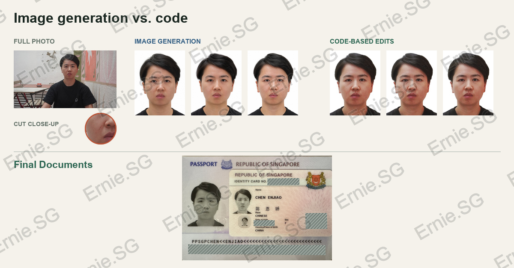

我最近成为新加坡公民了!🇸🇬

讽刺的是,公民身份获批并不是最难的部分,让 ICA(新加坡移民与关卡局)接受我的护照照片才是。

我花了 €40 和半天时间,在巴塞罗那拍了两次照片。就连专业修图后的照片也被拒了。

于是我做了任何一个沮丧的软件工程师都会做的事:写代码。

我先试了图像生成,但它会悄悄改变我的五官。对一份身份证件来说,这可不太理想。😂

基于代码的图像处理效果更好。我可以去除背景、裁剪、调整尺寸,甚至还能修掉我爬山时脸上留下的那道临时伤口。

结果,照片通过了!

*图像生成 vs. 基于代码的编辑,下方为最终的新加坡护照和身份证。*

## 一切皆代码

最糟糕的不是花掉的钱和时间,而是费了那么大劲,照片还是被拒了。摄影师无法满足精确到像素的规格要求,而每多修一次图,就要再收 €20。

后来我突然想到:要衡量我的脸是否恰好占照片的正确比例,还有谁比 AI 更合适?

而在 Photoshop 里做的那些手动编辑,比如裁剪、去背景、仿制图章,说到底都是软件操作。如今,AI 可以把这些操作写成代码并执行。

所以我在做 **Spindle Photos**。

自拍一张,选择国家和证件类型,就能得到按相关要求排版并检查过的照片,支持的证件还可无限次导出。

不用去照相馆,不用 Photoshop,也不会再有 €40 的意外开销。

**这是演示:**

<iframe alt="Spindle Photos demo" src="https://www.youtube.com/embed/dWwgoHECl54?feature=oembed" allowfullscreen="true" style="width: 100%; aspect-ratio: 16 / 9; height: auto; border: 0; margin: 0 0 2rem; "></iframe>

## 从“软件即服务”到“结果即服务”

这次经历让我思考:**在智能唾手可得的世界里,我们每天使用的哪些产品和服务已经不再合理?**

我们今天用的很多软件,都继承自早期的确定性计算时代。我们围绕计算机能做什么,而不是人真正想要什么,去设计界面、表单、菜单和流程。

但现在,我们可以把模型智能加进来了!

说到底,没有人因为喜欢点按钮或填表格而使用软件。我们用它,是为了达成自己在乎的结果。软件从来都只是手段。

我要的不是修图软件,甚至也不是摄影师。**我只是想要一张能被接受的护照照片。**

而且,为什么只限于照片?

学校、医院、银行和政府机构,仍然让我们一遍又一遍地填写同样的信息。为什么我不能直接让我的 AI 去看表格,自己把事情搞定?

而且,AI 光是翻翻我的文件然后给个答案还不够。我想知道每一条信息究竟来自哪里,能够核实它是否正确,并且只在缺少信息时才来问我。

我也不希望 AI 写出来的东西像互联网的平均水平。我希望它听起来像“我”,只是更擅长表达我真正想说的话。

**重点不在于把现有流程当作遗物保留下来,而是围绕结果重新设计它们。**

如果说上一个互联网时代给了我们“软件即服务”,也许下一个时代将给我们“结果即服务”。

我希望 AI 带来的生产力提升,最终落在这些地方:教育、医疗、住房等基本服务,甚至包括与政府打交道这种琐碎事务。

不只是更便宜的软件或更高的企业利润,而是让教师和医护人员少做行政工作,让公民少跑些冤枉路,让每个人有更多时间去做真正重要的事。

我们花了几十年学习如何使用计算机。现在,我们有机会让计算机围绕我们来工作。

这就是 **Spindle** 背后更大的想法:把所有我讨厌做的事,那些没有 AI 我可能永远不会去做的事,变成人人都能用上的能力。

所以……30 天后上线?🚀
